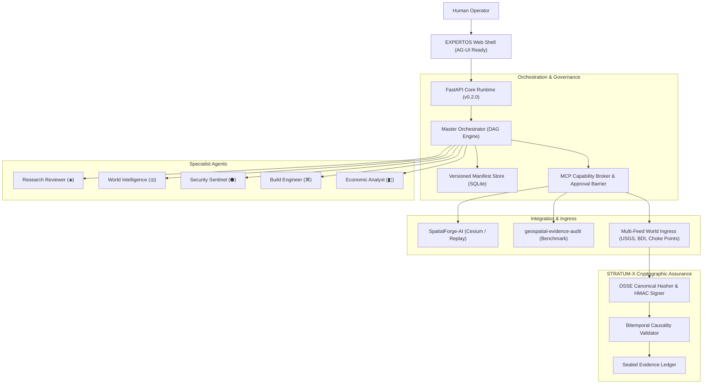

# ABOUT EXPERTOS-OS

## Executive Summary & Strategic Vision

**EXPERTOS-OS** is an open, extensible enterprise operating environment for human–AI multi-agent collaboration and planetary intelligence. It is engineered from first principles as an operating system for collective reasoning—not another static chatbot dashboard or wrapper.

The platform bridges three foundational systems:
1. **The Task-Specialist Agent Paradigm**: Scoped, versioned agent manifests where every domain specialist has an explicit objective, allowed tool boundaries, model routing policies, and evaluation contracts.
2. **SpatialForge Geographic & Telemetry Intelligence**: 3D planetary projection, coordinate fidelity, temporal replay trajectories, and multi-sensor fusion across seismic, macroeconomic, and maritime choke points.
3. **STRATUM-X Cryptographic Evidence Assurance**: Deterministic DSSE-style envelopes, SHA-256 canonical payload digests, HMAC signatures, and bitemporal causality auditing (`observed_at`, `available_at`, `ingested_at`).

---

## Core Problem Statement

Current LLM agent frameworks suffer from three systemic flaws in mission-critical and enterprise environments:

1. **Uncalibrated Hallucinations as "Live" State**: Models generate synthetic assertions without distinguishing live physical observations from delayed reports, statistical forecasts, historical baselines, or ungrounded inferences.
2. **Monolithic, Leaky Tool Privileges**: Agents are typically granted blanket shell or API access, enabling prompt injection, credential passthrough, and unapproved side-effects on live infrastructure.
3. **Static, Mismatched User Workspaces**: A single text-chat prompt box is expected to serve scientific research, geospatial orbital tracking, and financial contagion modeling.

---

## The Three Fundamental Architectural Axioms

### Axiom 1: Every Agent Is a Versioned Contract
Every specialist in EXPERTOS-OS is defined by an immutable, versioned [`AgentManifest`](file:///Users/favl/Downloads/expertos-world-os/app/manifest.py). Custom agents get **zero tools by default**. Adding tools requires an administrative scope binding, a signed capability manifest, and an out-of-band execution broker. Any modifying side-effect tool halts execution until approved by a verified human operator.

### Axiom 2: Task-Generated Ephemeral Interfaces
Interfaces are ephemeral and generated specifically for the assigned task. A geospatial agent produces a globe and temporal tracks; a research reviewer produces an evidence register and falsification protocol; a software engineer produces code diffs and CI gates. These workbenches automatically unmount after session expiry (15-minute default TTL) while evidence and decision records remain durably preserved in the audit log. **Models are strictly prohibited from generating executable client code, HTML, or scripts.**

### Axiom 3: Evidence-First World Ladder
World intelligence adheres to the strict **Live World-Source Ladder**:
$$\text{LIVE\_OBSERVATION} \succ \text{NEAR\_REAL\_TIME} \succ \text{HISTORICAL} \succ \text{FORECAST} \succ \text{SIMULATION} \succ \text{UNAVAILABLE}$$
The system **never** represents a synthetic visualization as a live observation. If an external sensor or intelligence feed is unreachable, it is visibly marked as `UNAVAILABLE` rather than populated with simulated events.

---

## Technical Taxonomy

---

## Multi-Repository Synergy

| Repository | Upstream Role | EXPERTOS-OS Adapter |
|---|---|---|
| **[SpatialForge-AI](https://github.com/FrankAsanteVanLaarhoven/SpatialForge-AI)** | Principal 3D world-visualization foundation | Cesium Ion camera trajectories, WGS84 coordinate projections, and temporal replay tracks |
| **[geospatial-evidence-audit](https://github.com/FrankAsanteVanLaarhoven/geospatial-evidence-audit)** | Evidence assurance & adversarial benchmarks | Adversarial test harnesses, spoofed telemetry detection, and 100% precision abstention protocol |
| **[spatialforge-services](https://github.com/FrankAsanteVanLaarhoven/spatialforge-services)** | Deployment & cryptographic service foundation | Service topology discovery, Ed25519 DSSE envelope parsing, and containerized deployment |

---

## Enterprise Governance & Compliance

- **Zero Credential Passthrough**: Prevents token leakage to external models or logs.
- **Human-in-the-Loop Barrier**: State-changing tool invocations require operator approval.
- **Auditability**: Every inference run is tagged `MODEL_UNVERIFIED` until backed by signed evidence.
- **Container Isolation**: Multi-stage, unprivileged Docker build (`UID 10001`, `cap_drop: ALL`).

