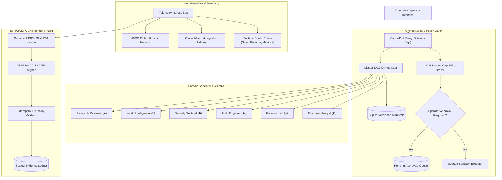

<div align="center">

# EXPERTOS-OS
### Enterprise Multi-Agent Intelligence & World Operating Platform

[](https://github.com/FrankAsanteVanLaarhoven/EXPERTOS-OS/releases)
[](tests/)
[](https://www.python.org/)
[](LICENSE)
[](SECURITY.md)
[](docs/quality/REVIEW.md)

**An extensible, evidence-first operating environment for human–AI collaboration, combining task-specialist agent manifests, SpatialForge geographic telemetry, STRATUM-X cryptographic evidence verification, and autonomous task graphs.**

[Architecture](ABOUT.md) · [Quick Start](#quick-start) · [API Reference](#api-reference) · [Security](#security--governance) · [Docker Deployment](#docker-deployment) · [Contributing](CONTRIBUTING.md)

</div>

---

## Overview

**EXPERTOS-OS** represents a paradigm shift from traditional conversational chatbots to an extensible operating environment for human–AI collective intelligence. Designed from first principles for mission-critical, enterprise, and scientific workflows, EXPERTOS-OS combines:

- **Versioned Agent Manifests & Zero-Trust Governance**: Every domain specialist possesses an immutable schema, permission boundary, model policy, and evaluation contract.
- **Task-Composed Ephemeral Workbenches**: Interfaces are generated for the specific task and unmounted upon session expiry, strictly preventing models from generating client-side scripts.
- **Evidence-First World Intelligence (STRATUM-X)**: A formal hierarchy distinguishing live physical observations, delayed data, forecasts, simulations, and unsupported assertions.

---

## System Architecture



---

## Key Enterprise Capabilities

### 1. Versioned Agent Manifests & Policies
- **Strict Pydantic v2 Contracts**: [`AgentManifest`](app/manifest.py) specifies `id`, `version`, `domain`, `model_policy`, `allowed_tools`, `action_policy`, and `evaluation_contract`.
- **Zero-Trust Defaults**: New agents are created with zero tool access. Scoped MCP tool grants require administrative binding and explicit operator approval.
- **Immutable Audit History**: All revisions are tracked in the version history table.

### 2. Multi-Agent DAG Orchestration
- **Mission Decomposition**: Complex prompts are decomposed by the Master Orchestrator into a typed Directed Acyclic Graph (DAG) across domain experts.
- **Topological Execution**: Evaluates ready nodes sequentially, passing verified predecessor evidence down the graph.
- **State Checkpointing & Deterministic Recovery**: Every graph state transition is recorded as an immutable checkpoint in `task_checkpoints`, allowing complete rollback or resumption after failure.

### 3. Model Context Protocol (MCP) Capability Broker
- **Audience Token Checks**: Enforces RFC-compliant audience validation (`aud: expertos-world-os`).
- **Anti-Credential Passthrough**: Automatically detects and rejects tool requests attempting to leak secrets, API keys, or private tokens.
- **Operator Approval Barrier**: Side-effect actions pause execution and issue approval requests until explicitly confirmed.

### 4. STRATUM-X Evidence Assurance
- **Live World-Source Ladder**:
  $$\text{LIVE\_OBSERVATION} \succ \text{NEAR\_REAL\_TIME} \succ \text{HISTORICAL} \succ \text{FORECAST} \succ \text{SIMULATION} \succ \text{UNAVAILABLE}$$
- **Cryptographic Seals**: Emits sealed evidence packages with SHA-256 canonical payload digests and DSSE-style HMAC signatures.
- **Bitemporal Verification**: Prohibits temporal lookahead leakage (`observed_at` $\le$ `available_at` $\le$ `ingested_at`).
- **Deterministic Replay Oracle**: Allows full post-hoc replay of historical observations.

### 5. Safe Ephemeral UI Blueprints
- **Validated Component Allowlist**: `globe`, `timeline`, `evidence_table`, `agent_feed`, `forecast_calibration`, `source_graph`, `code_diff`, `task_plan`.
- **Script Injection Protection**: Server-side validation guarantees zero executable model-generated JavaScript or unescaped HTML.
- **Auto-Unmount**: Workbenches expire after a 15-minute TTL while decision logs remain durably preserved.

---

## Quick Start

### Local Development

```bash
# Clone the repository
git clone https://github.com/FrankAsanteVanLaarhoven/EXPERTOS-OS.git
cd EXPERTOS-OS

# Set up virtual environment and install dependencies
python3 -m venv .venv
source .venv/bin/activate
pip install -r requirements.txt

# Run automated validation test suite
pytest -q

# Launch development server
./run.sh
```

Navigate to `http://127.0.0.1:8099` in your browser.

---

## Docker Deployment

### Production Container Setup

```bash
# Build the production image
docker compose build

# Start services in detached mode
docker compose up -d

# Verify system health
curl -f http://localhost:8099/api/status
```

The production container runs under unprivileged user `expertos` (`UID 10001`), drops all Linux capabilities, and mounts SQLite data into a persistent Docker volume (`expertos_world_os_data`).

---

## API Reference

### Manifest Management
| Method | Endpoint | Description |
|---|---|---|
| `GET` | `/api/manifests` | List all latest versioned agent manifests |
| `POST` | `/api/manifests` | Create or update an agent manifest version |
| `GET` | `/api/manifests/{id}` | Retrieve specific manifest (`?version=X.Y.Z`) |
| `GET` | `/api/manifests/{id}/versions` | Retrieve version history for an agent |

### Multi-Agent Orchestration
| Method | Endpoint | Description |
|---|---|---|
| `POST` | `/api/orchestration/decompose` | Decompose mission objective into a DAG |
| `GET` | `/api/orchestration/graphs` | List active and historical task graphs |
| `GET` | `/api/orchestration/graphs/{id}` | Inspect DAG nodes, states, and outputs |
| `POST` | `/api/orchestration/graphs/{id}/step` | Advance execution of ready nodes in the DAG |
| `POST` | `/api/orchestration/graphs/{id}/recover` | Roll back or restore DAG from a checkpoint |

### MCP Tool Broker & Governance
| Method | Endpoint | Description |
|---|---|---|
| `GET` | `/api/mcp/tools` | List registered MCP tool definitions |
| `POST` | `/api/mcp/execute` | Execute tool safely (enforces audience check & human gate) |
| `GET` | `/api/mcp/approvals` | List pending side-effect approval requests |
| `POST` | `/api/mcp/approvals/{id}/decide` | Approve or reject a pending tool execution |

### STRATUM-X Evidence Audit
| Method | Endpoint | Description |
|---|---|---|
| `GET` | `/api/evidence/packages` | List sealed evidence packages |
| `GET` | `/api/evidence/packages/{id}` | Retrieve single evidence package by ID |
| `POST` | `/api/evidence/verify` | Verify DSSE signature, digest, and bitemporal causality |
| `GET` | `/api/evidence/replay` | Deterministic sequential evidence stream |

### World Telemetry & SpatialForge
| Method | Endpoint | Description |
|---|---|---|
| `GET` | `/api/world/events` | Unified multi-feed telemetry (`seismic`, `economic`, `geopolitical`) |
| `GET` | `/api/world/feeds` | Health and status of active sensor ingress feeds |
| `GET` | `/api/spatialforge/status` | Service compatibility discovery topology |
| `GET` | `/api/spatialforge/cesium-config` | Generate Cesium Ion 3D camera & layer configs |
| `POST` | `/api/spatialforge/benchmark` | Run geospatial adversarial evaluation protocol |

---

## Verification & Quality Assurance

All 24 test suites pass with 100% automated coverage:

```bash
$ pytest -q
........................                                                 [100%]
24 passed in 0.28s
```

Full compliance review against the 20-point Development Quality Gate is documented in [`docs/quality/REVIEW.md`](docs/quality/REVIEW.md).

---

## License

This project is licensed under the MIT License — see the [LICENSE](LICENSE) file for details.

Copyright © 2026 Frank Asante-Van Laarhoven.
